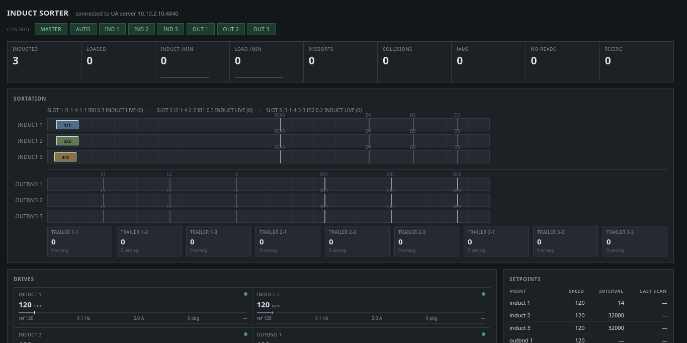
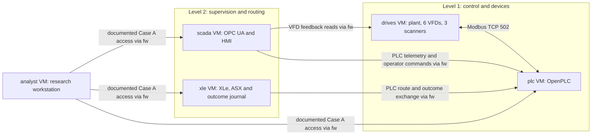

# ICS Sorter Range

An OT security lab I built for IS-4543 Cyber Attack and Defend at UTSA. It simulates a three-lane package sorter feeding nine trailer doors, modeled on the parcel sortation systems I operate, split across Purdue Levels 1 to 3 behind a firewall. Over five milestones I build it, baseline it, attack it, write detections for it, and harden it.

An OpenPLC controller runs the sorting logic. Python services emulate the drives, scanners, plant, and routing service, and a SCADA layer serves the process over OPC UA to an HMI. Everything talks Modbus TCP and OPC UA, the same protocols found on real plant floors.

| Milestone | What it covers | Folder |
| --- | --- | --- |
| 1. Build | The range, its network segmentation, and a working three-lane sort | [m1-build](milestones/m1-build) |
| 2. Baseline | One hour of normal healthy-idle traffic, captured and analyzed | [m2-baseline](milestones/m2-baseline) |
| 3. Attack | Modbus and OPC UA attacks, measured against the baseline | [m3-attack](milestones/m3-attack) |
| 4. Detect | Detections for the Milestone 3 attacks | [m4-detect](milestones/m4-detect) |
| 5. Harden | Tighter segmentation and OPC UA security, then re-measure | [m5-harden](milestones/m5-harden) |

[Watch the Milestone 1 demonstration](docs/videos/Milestone_1_Sorter_Demonstration.webm)



*The HMI with three packages moving at once, from Milestone 1.*

## How the range is arranged



Every VM routes through the `fw` VM, which enforces the allowed flows between zones with nftables. The PLC polls the drives and scanners on Level 1. On Level 2, SCADA polls the PLC and serves the HMI over OPC UA, and XLe exchanges routing decisions with the PLC, asking its ASX sort-plan service over local loopback.

The `analyst` VM is the attacker's starting point. In Case A, the configuration attacked in Milestone 3, it intentionally has broad access to every zone. Milestone 5 tightens that and measures the difference. See the [network notes](milestones/m1-build/NETWORK_DIAGRAM.md) for how the topology changed over time.

| Component | Where to start | Role |
| --- | --- | --- |
| PLC | [Sorter.st](Sorter.st) | The Structured Text sorting program |
| Plant and devices | [devices/](devices/) · [deployment notes](deploy/README.md) | Motion model, six VFDs, three tunnel scanners |
| Routing | [services/](services/) · [XLe VM migration](docs/design/XLE_VM_MIGRATION.md) | XLe and its journal-backed exchange with the PLC; ASX sort plan |
| Operator view | [scada/](scada/) · [SCADA notes](scada/README.md) | OPC UA server and HMI |
| Segmentation | [firewall configuration](deploy/firewall/) | Zone rules and the Case A forwarding policy |

## Explore locally

The host-side tests run without the VMs. Use Python 3.11 from the repository root:

```sh
python3.11 -m venv .venv
. .venv/bin/activate
pip install -r requirements-dev.txt
python -m unittest discover -s tests -p 'test_*.py' -v
```

These check the code, not a running range. [TESTING.md](TESTING.md) explains the difference between host tests and live checks.

## Read further

- [Documentation guide](docs/README.md): design contracts, deployment, and tests in reading order
- [Network notes](milestones/m1-build/NETWORK_DIAGRAM.md): the current topology and how it changed
- [Deployment and manifest](deploy/README.md): what runs on each VM
- [Contributing](CONTRIBUTING.md)

This is a simulation for research and teaching, not a production control system.
